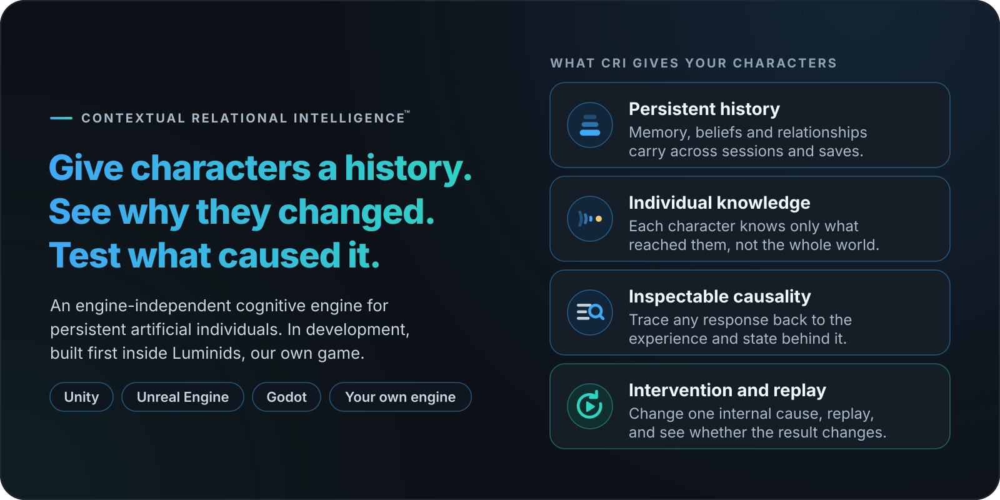
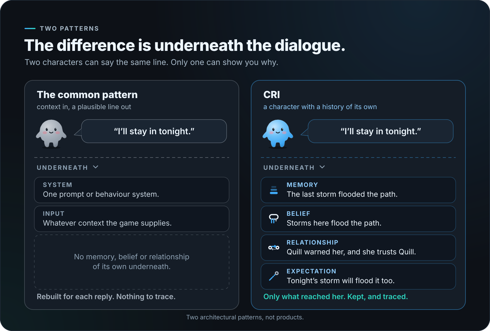
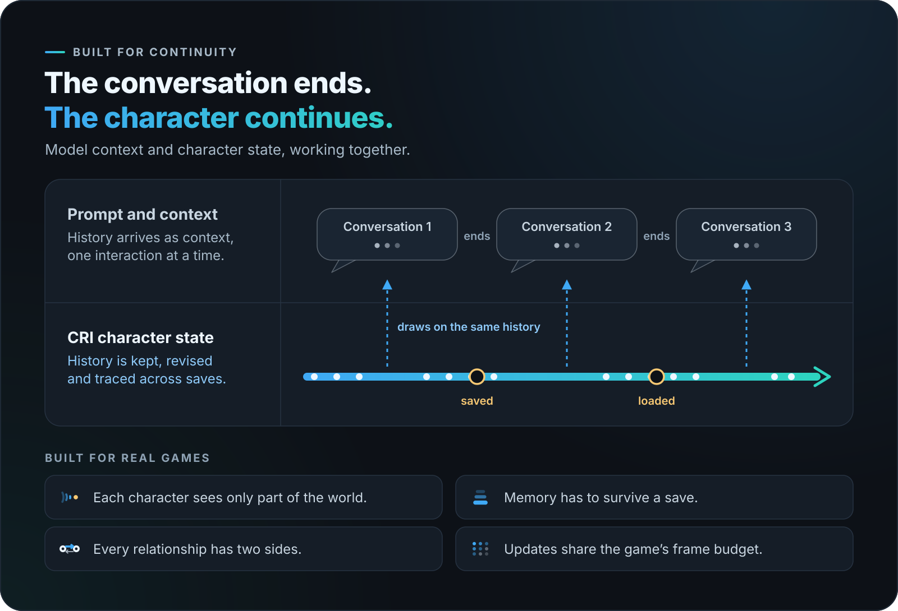
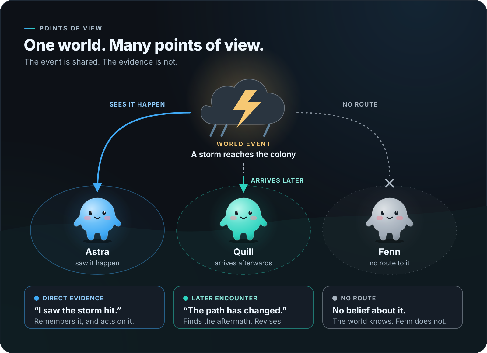
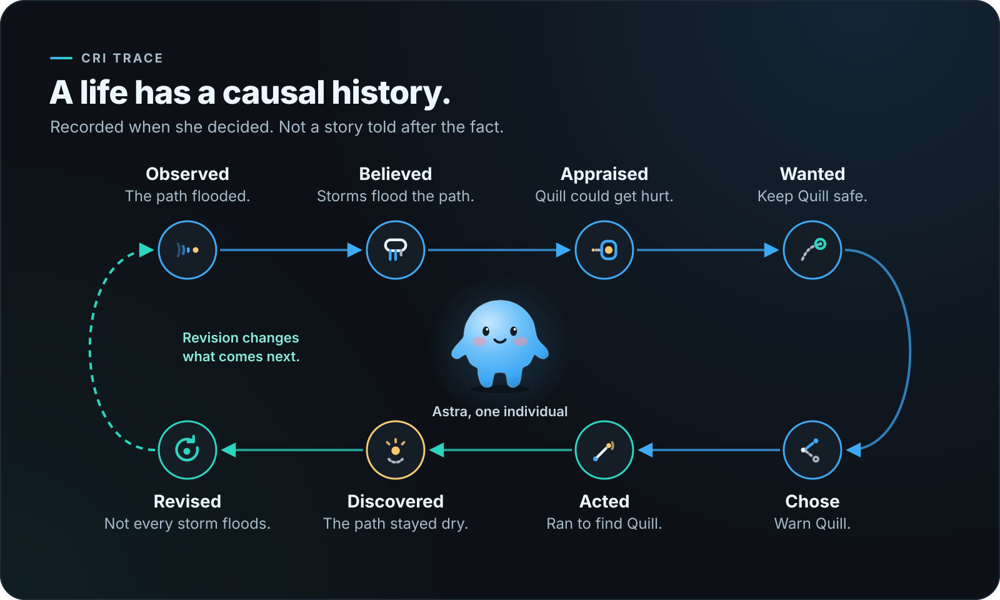
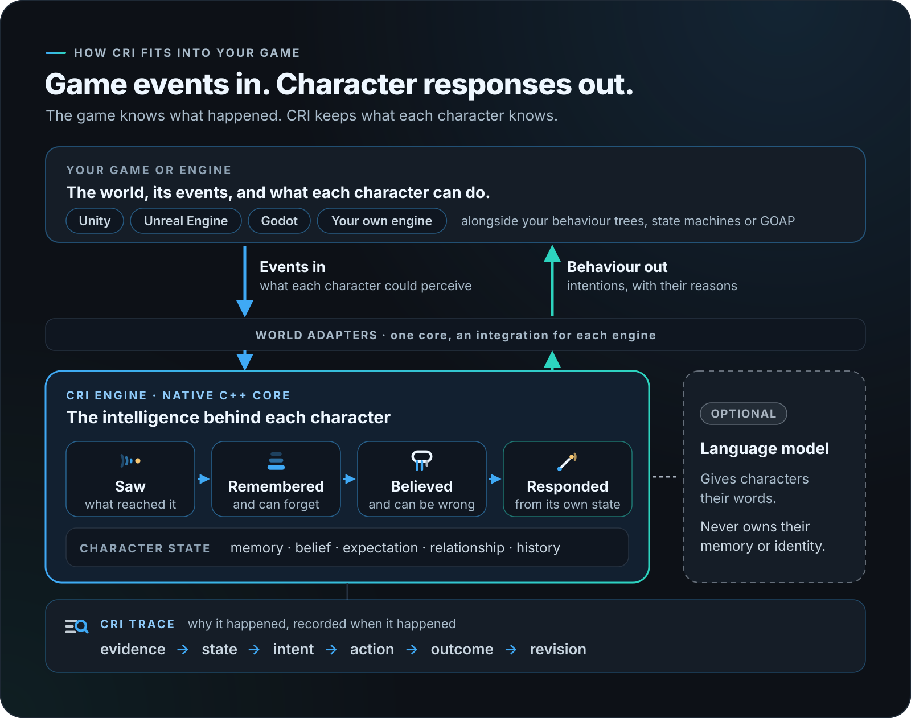
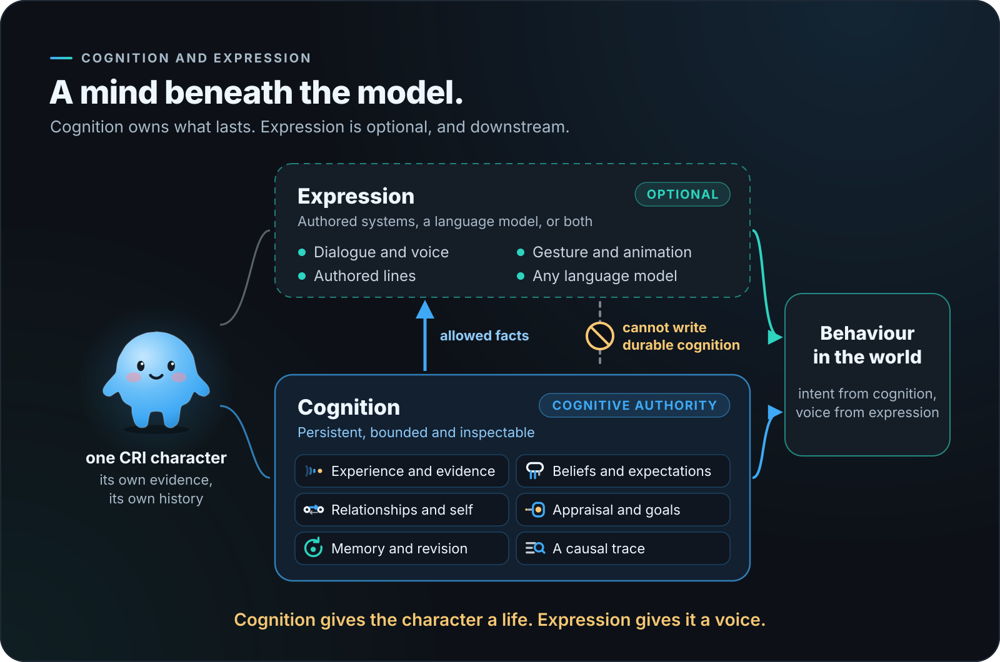
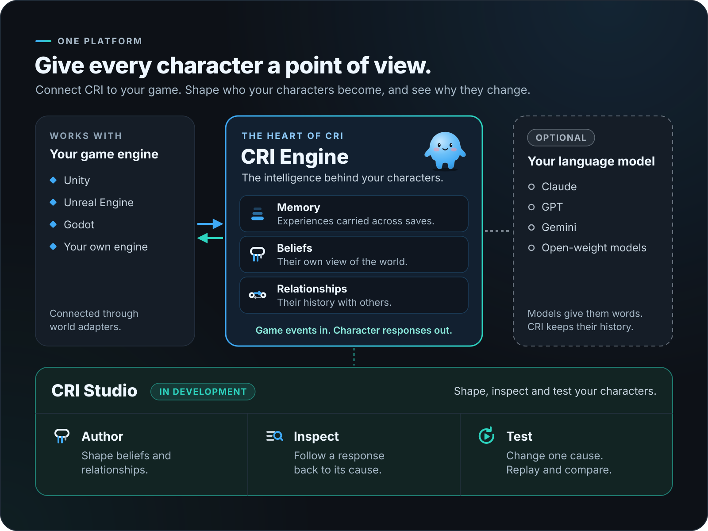
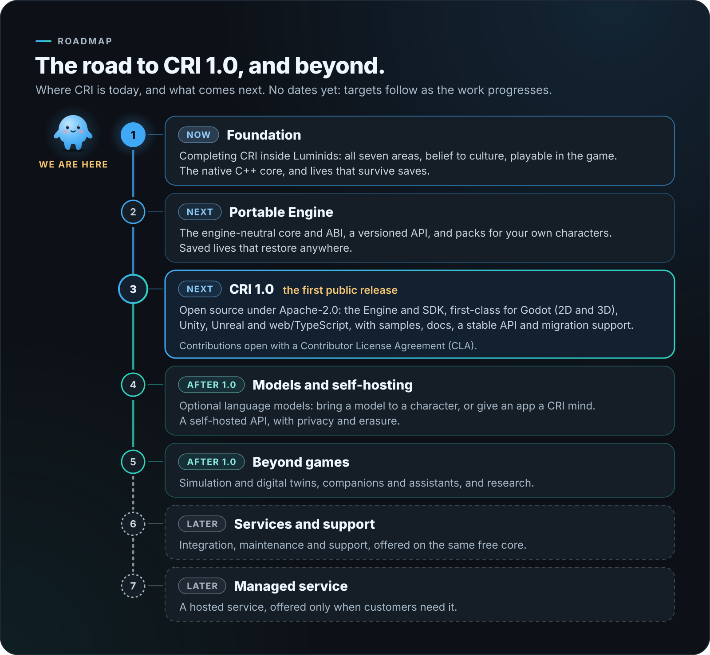

# Contextual Relational Intelligence™

### Give artificial characters a past. Let it shape their future.

**Contextual Relational Intelligence™ (CRI) is a cognitive engine for creating persistent artificial individuals, being prepared for release as open source.**

Characters who remember. Who learn from experience. Who develop relationships, form beliefs, build expectations, make decisions and grow through the things that happen to them.

Every individual has their own perspective, shaped by what they've seen, what they've learned, who they've met and what they've experienced.

Their history becomes part of who they are, influencing how they understand the world and what they choose to do next.

**Our ambition is to give developers everywhere the foundations to create artificial individuals with lives of their own.**

CRI began as the cognitive technology behind [Luminids](https://www.luminids.com), a cozy colony adventure where every little creature has its own personality, memories, relationships and developing story.

What started as an experiment in making game characters feel genuinely alive has grown into something much bigger.

We're building CRI as a portable, extensible engine that anyone can use, explore, improve and build upon.

> **Development status:** CRI is in active private development. Its native C++ core and API are being developed alongside Luminids, with standalone SDKs and integrations planned for the open-source release. The project will become publicly available once its release, security and licensing preparation is complete.

---

## A different way to think about artificial intelligence

Imagine a world full of characters, each experiencing that world differently.

One character remembers someone helping them through a difficult moment. Another remembers being disappointed by that same person.

One has explored the mountains and knows the way home. Another has only heard stories about what lies beyond the village.

One expects a friend to keep a promise. Another has learned to be cautious.

They share the same world, but each carries a different history.

Over time, those experiences influence what they believe, what they value, who they trust and the choices they make.

**That's the idea behind CRI: intelligence shaped by lived experience.**

We believe some of the most interesting behaviour emerges when individuals develop their own understanding of the world, rather than sharing a single perspective.

CRI gives developers a foundation for exploring exactly that.

## The conversation ends. The character continues.

## What CRI brings to your characters

### Individual experience and memory

Every character develops their own history through observations, interactions and events.

Their experiences can remain relevant long after the moment has passed, shaping future decisions and relationships.

### Beliefs and perspectives

Characters build an understanding of the world from the information available to them.

They can believe different things about the same situation, discover new evidence, reconsider their assumptions and change their minds.

### Relationships that develop

Shared experiences matter.

Friendships, trust, expectations, disagreements and reconciliation can influence how characters perceive and respond to one another.

Over time, relationships become part of an individual's developing history.

### Emotion and personal meaning

An experience can carry different significance for different individuals.

CRI's research explores how needs, relationships, emotional appraisals and personal history influence the meaning of an event and the decisions that follow.

### Expectations and learning

Characters can anticipate what might happen, recognise when events unfold differently and adapt their understanding.

Their experiences become part of how they approach future situations.

### Decisions with understandable reasons

CRI is designed to capture the information and causes behind decisions at the moment those decisions are made.

Developers can explore what an individual knew, what they believed, which possibilities they considered and why a particular action was chosen.

### Persistent identity

A character's story continues across sessions.

Memories, beliefs, relationships and relevant experiences can survive saving, restoring and evolving worlds.

**The aim is continuity: individuals whose past continues to matter.**

These capabilities form CRI's evolving cognitive architecture. Individual mechanisms are at different stages of implementation, validation and research.

---

## Meet the CRI Engine

**The Engine is the heart of CRI.**

We're building a portable cognitive runtime that developers can integrate into games, simulations, research environments and other applications.

Your application provides the world, its events and the actions available to each individual.

CRI manages supported cognitive state, interprets the information each individual acquires, evaluates decisions and preserves the history that shapes future behaviour.

The resulting intentions return to your application, which carries out the actions and reports their outcomes.

This architecture allows CRI to work alongside existing gameplay systems, simulation frameworks, character controllers and optional AI models.

### Give every character a point of view

### Built for developers

Our technical direction includes:

- **Native C++ Engine:** A portable cognitive core designed for performance and integration across environments.
- **Versioned API:** Clear interfaces for observations, cognitive state, decisions, outcomes and persistence.
- **Developer SDKs:** Accessible language bindings, examples and integration packages.
- **Deterministic execution:** Reproducible cognitive behaviour under controlled inputs, with dedicated testing and evaluation.
- **Persistent state:** Versioned snapshots and continuity across sessions.
- **Causal inspection:** Tools and APIs for understanding the recorded reasons behind decisions.
- **Customisable behaviour:** Policies, actions and world integration controlled by developers.
- **Optional language models:** Connect conversational and reasoning capabilities to persistent individual state.
- **Local and self-hosted operation:** Run CRI within your own application or infrastructure.

The native core already has a C API under development. Our public SDK and platform support will grow from that foundation.

## Where CRI can run

CRI is being developed around an engine-independent cognitive core, opening the door to a wide range of integrations.

| Platform | Integration direction |
|---|---|
| **Godot** | Native integration and GDExtension |
| **Unity** | C# SDK and native runtime |
| **Unreal Engine** | Native C++ SDK |
| **C / C++** | Direct integration with the core API |
| **Python** | Simulation, research and application development |
| **JavaScript / TypeScript** | WebAssembly and service integration |
| **Custom applications** | Versioned API and self-hosted services |

Our goal is for developers to bring CRI into their existing technology and build the experiences they imagine.

Platform integrations will be released as their implementation and compatibility testing are completed.

---

## The cognitive research behind CRI

CRI is an ongoing exploration of how artificial individuals can develop through experience.

The research programme is organised into seven progressive areas:

| Area | Research focus |
|---|---|
| **P1 — Belief** | Acquiring evidence, forming beliefs and revising understanding |
| **P2 — Perspective** | Interpreting experiences through personal needs, history and relationships |
| **P3 — Expectation** | Anticipating outcomes, recognising surprises and learning |
| **P4 — Self** | Developing beliefs about one's own abilities, experiences and identity |
| **P5 — Communication** | Sharing knowledge, testimony, understanding and correction |
| **P6 — Expression** | Expressing internal states through behaviour, manner and presentation |
| **P7 — Culture** | Exploring how shared experiences, customs and knowledge develop across communities |

Each area introduces new questions, mechanisms and opportunities for research.

Our approach combines implementation with measurable evidence. We want to understand how a character's experiences influence what it does, and reproduce those differences through controlled experiments.

### Four principles guide the work

**1. Decision-time causality**

The reasons behind decisions are grounded in information captured when those decisions occurred.

**2. One cognitive foundation**

The game, developer integrations and research tools share the same underlying cognitive primitives.

**3. Meaningful cognitive influence**

Cognitive mechanisms earn their place by demonstrating how they influence interpretation, appraisal or behaviour.

**4. Continuity through experience**

Persistent state preserves the meaningful connections between an individual's history and its future.

These principles shape how CRI is designed, tested and developed.

---

## Born in Luminids

CRI started with a simple ambition: **make the little creatures in Luminids feel like individuals whose lives actually matter.**

We wanted them to remember one another. To develop friendships. To learn from their mistakes. To care about things for their own reasons.

To have small stories that belong to them.

Luminids has become CRI's first living development environment.

Its persistent world gives us opportunities to explore cognition through everyday life: working, building, exploring, learning, caring, socialising and growing together.

The game also presents valuable engineering challenges, including real-time performance, large populations, partial information, continuous simulation and persistent worlds.

We're developing CRI through those challenges and preparing its underlying technology for use beyond Luminids.

[**Discover Luminids**](https://www.luminids.com)

---

## Beyond gaming

We believe persistent individual cognition has applications far beyond game characters.

The same foundations that allow a character to develop an individual perspective can support other systems where experience, memory, interpretation and continuity matter.

### Simulation and artificial societies

Create populations of individuals with different knowledge, relationships, expectations and histories.

Explore how communities develop, how information spreads and how individual decisions influence larger systems.

### Autonomous AI agents

Give long-running agents persistent structured context, revisable beliefs and a history of decisions and outcomes.

Explore continuity across tasks, sessions and changes in underlying reasoning models.

### Robotics and embodied intelligence

Investigate how embodied agents can connect observations, experiences, expectations and outcomes through a persistent cognitive layer.

### Education and interactive training

Develop simulated individuals whose responses evolve through interaction, creating opportunities for training, rehearsal and exploration.

### Companions and interactive experiences

Create persistent personalities with shared histories, individual perspectives and continuity across interactions.

### Research and cognitive science

Provide a platform for experiments involving artificial memory, belief formation, social cognition, behavioural development and multi-agent systems.

These are emerging opportunities for investigation. Each new domain brings its own requirements for validation, reliability, privacy and responsible use.

**Our long-term vision is an open foundation for persistent artificial cognition, useful wherever individual experience can meaningfully shape behaviour.**

---

## Open source, for everyone

CRI is being prepared for release as a genuinely open-source project.

We believe the ability to build persistent artificial individuals should be available to developers, researchers, students, hobbyists and studios of every size.

We want people to experiment, ask questions, improve the technology and take it in directions we haven't imagined.

Our intended open-source approach includes:

- Free access to the CRI Engine and SDK.
- Freedom to study, modify and extend the source code.
- Commercial use in independently developed products.
- Community contributions and shared development.
- Open APIs, documented formats and portable integrations.
- Public examples, tutorials and learning resources.
- Transparent testing, research and technical limitations.
- A community built around curiosity, collaboration and creation.

We hope CRI becomes something people build upon for years to come.

Some will create games. Others might build simulations, research tools, interactive experiences or entirely new kinds of applications.

**The more people create with CRI, the more valuable the shared foundation becomes.**

LuminidsAI intends to steward the project, maintain its technical direction and support its development. Over time, optional professional services or infrastructure may help sustain that work.

The Engine and SDK remain the centre of our open-source vision.

---

## Roadmap

Where CRI is today, and what comes next, in seven stages.

1. **Foundation** · *Now* — Completing CRI inside Luminids: all seven research areas, from belief to culture, playable in the game; the native C++ core; and lives that survive saves.
2. **Portable Engine** · *Next* — The engine-neutral core and ABI, a versioned API, packs for your own characters, and saved lives that restore anywhere.
3. **CRI 1.0** · *Next* — The first public release, open source under the Apache License 2.0: the Engine and SDK, first-class for Godot (2D and 3D), Unity, Unreal and web/TypeScript, with samples, documentation, a stable API and migration support. Contributions open with a Contributor License Agreement.
4. **Models and self-hosting** · *After 1.0* — Optional language-model integrations, to bring a model to a character or give an app a CRI mind, and a self-hosted API with privacy and erasure.
5. **Beyond games** · *After 1.0* — Simulation and digital twins, companions and assistants, and research.
6. **Services and support** · *Later* — Integration, maintenance and support, offered on the same free core.
7. **Managed service** · *Later* — Offered only when customers need it.

We'll publish release targets and supported platform details as development progresses.

---

## Licensing

CRI is currently in private, pre-release development.

We intend to publish the Engine and SDK under the Apache License 2.0.

The final grant will follow the necessary ownership, dependency and intellectual-property review.

Until publication, the source remains © 2026 NJX Technologies Ltd., all rights reserved. Public usage and redistribution rights will be established by the released licence.

Contextual Relational Intelligence™ is a trademark of NJX Technologies Ltd.

## Support CRI

CRI is free, and it will be open source. If you'd like to help fund its development, you can sponsor it through [GitHub Sponsors](https://github.com/sponsors/njacobx). Sponsorship is entirely optional, and simply helps the work continue.

## Contributing

Community contributions will open with a Contributor License Agreement (CLA) when CRI 1.0 ships.

Contribution guidelines, issue tracking, development discussions and technical documentation will accompany the release.

In the meantime, follow the project at [luminids.ai](https://luminids.ai).

---

## Why we're doing this

CRI began with curiosity.

I wanted to explore what happens when artificial characters have experiences that genuinely matter to them. When their memories influence their choices, when their relationships grow, and when the things they live through become part of who they are.

That curiosity led to Luminids, and eventually to a much wider idea.

I believe there's something valuable here. Something worth exploring, sharing and building upon together.

My hope is that CRI gives other creators a foundation for their own ideas, and that the community takes it further than I ever could alone.

If it helps someone build a wonderful game, explore a fascinating research question or create something entirely new, then sharing it will have been worthwhile.

**Create freely. Share knowledge. Build something meaningful.**

I'm excited to see where this goes.

**Nick Jacob**  
*Creator of Contextual Relational Intelligence*  
LuminidsAI · [luminids.ai](https://luminids.ai)
